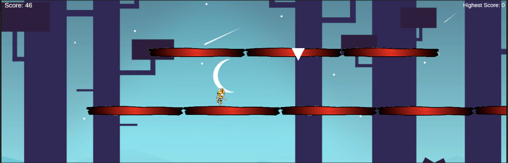

# Gravity Guy

A 2D Gravity Flip / Gravity Guy clone by Eden Bager.
The player runs forward automatically and flips gravity to avoid spikes and gaps.
Survive as long as possible — speed and difficulty increase over time.

🎮 Features
	•	Auto-run & gravity flip (Space / Click / Tap).
	•	Randomized spikes & platforms with object pooling.
	•	Score & high score saved (PlayerPrefs).
	•	Game Manager singleton for Menu / Game / GameOver states.
	•	UI: Score, Help, Retry/Menu panels (TextMeshPro).
	•	Background music, flip & hit SFX.
	•	Smooth camera follow.

🧩 Scenes
	•	MainMenu – Play / Help / Exit + High Score.
	•	Game – Main gameplay.

🛠️ How to Run
	1.	Open project in Unity 6.0.0f1 (or higher).
	2.	Open Assets/Scenes/MainMenu.unity.
	3.	Press Play.
	4.	Controls: Space / Left Click / Tap to flip gravity.

💾 Build
	•	File → Build Settings → Add both scenes (MainMenu, Game).
	•	Platform:Mac & Android Standalone.
	•	Click Build and Run.
